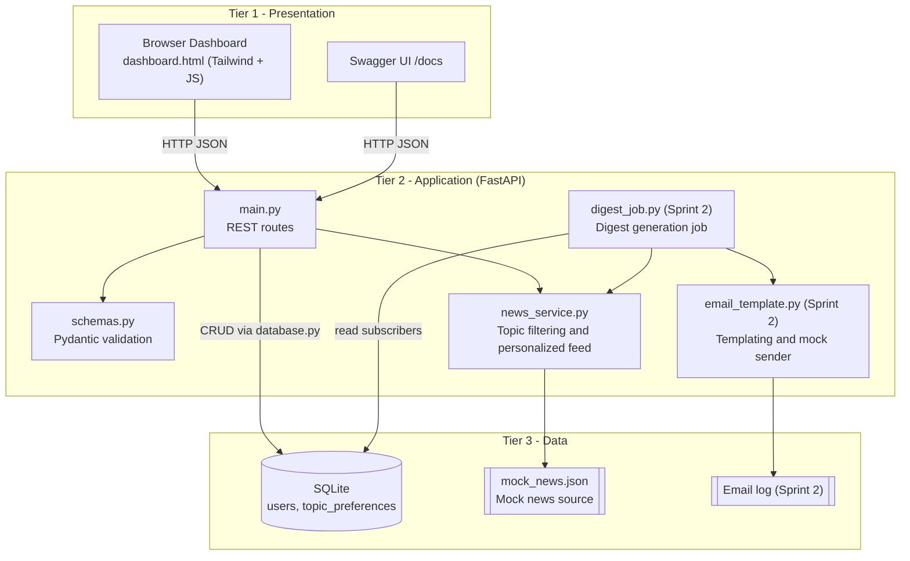

# System Architecture Document (SAD)

**Project:** Personalized News Emailer | **Version:** 1.0 | **Team:** 15

| Name | SRN | Role |
|------|-----|------|
| Mirunjai Suresh Kumar | PES1UG24AM161 | Architecture, CI/CD, PR reviews |
| Kota Videesha | PES1UG24AM140 | Database schema, preference APIs |
| Keerthishree R | PES1UG24AM132 | News service, UI |
| Nayana S M | PES1UG24AM174 | Documentation, unit tests |

## 1. Architectural Style
The system follows a **3-tier modular architecture**: presentation, application (business logic) and data. Each tier
talks only to the adjacent one, and each module has a single responsibility, which keeps units testable and replaceable.

## 2. Architecture Diagram



## 3. Database Schema (SQLite)

### 3.1 Table `users`
| Column | Type | Constraints | Description |
|--------|------|-------------|-------------|
| id | INTEGER | PRIMARY KEY AUTOINCREMENT | Surrogate key |
| email | TEXT | NOT NULL, UNIQUE | Normalised (lowercase) email |
| created_at | TEXT | NOT NULL | ISO-8601 UTC timestamp |

### 3.2 Table `topic_preferences`
| Column | Type | Constraints | Description |
|--------|------|-------------|-------------|
| id | INTEGER | PRIMARY KEY AUTOINCREMENT | Surrogate key |
| user_id | INTEGER | NOT NULL, FOREIGN KEY users(id) ON DELETE CASCADE | Owner |
| topic | TEXT | NOT NULL | One of the five valid topics |
| (user_id, topic) | - | UNIQUE | A topic is stored once per user |

Relationship: `users` 1 --- N `topic_preferences`.

```sql
CREATE TABLE IF NOT EXISTS users (
    id INTEGER PRIMARY KEY AUTOINCREMENT,
    email TEXT NOT NULL UNIQUE,
    created_at TEXT NOT NULL
);
CREATE TABLE IF NOT EXISTS topic_preferences (
    id INTEGER PRIMARY KEY AUTOINCREMENT,
    user_id INTEGER NOT NULL REFERENCES users(id) ON DELETE CASCADE,
    topic TEXT NOT NULL,
    UNIQUE (user_id, topic)
);
```

## 4. API Endpoint Specifications

Valid topics: `technology`, `finance`, `sports`, `health`, `science`.

### 4.1 `POST /api/subscribe`
Request:
```json
{"email": "user@example.com", "topics": ["technology", "science"]}
```
Response `201 Created`:
```json
{"email": "user@example.com", "topics": ["technology", "science"], "created_at": "2026-03-10T09:00:00+00:00"}
```
Errors: `400` `{"detail": "Email already subscribed"}`; `422` invalid email or topic.

### 4.2 `GET /api/preferences/{email}`
Response `200 OK`:
```json
{"email": "user@example.com", "topics": ["technology", "science"], "created_at": "2026-03-10T09:00:00+00:00"}
```
Errors: `404` `{"detail": "User not found"}`.

### 4.3 `PUT /api/preferences/{email}`
Request:
```json
{"topics": ["finance", "health"]}
```
Response `200 OK`: updated user object (same shape as 4.2).
Errors: `404` unknown user; `422` invalid or empty topics.

### 4.4 `GET /api/news`
| Query parameter | Meaning |
|-----------------|---------|
| `topic` | One topic or a comma-separated list, e.g. `finance,sports` |
| `email` | Personalized feed from the subscriber's saved topics (takes precedence over `topic`) |
| (none) | All articles |

Response `200 OK`:
```json
[
  {
    "id": 1,
    "title": "Open-Source AI Toolkit Reaches 1.0 Milestone",
    "source": "TechWire",
    "topic": "technology",
    "summary": "After two years of community development...",
    "published_at": "2026-03-02T08:30:00Z"
  }
]
```
Errors: `400` invalid topic; `404` unknown email.

### 4.5 `GET /`
Returns the HTML dashboard.

## 5. Component Breakdown

### 5.1 Sprint 1 (implemented)
| Component | File | Owner | Responsibility |
|-----------|------|-------|----------------|
| CI/CD pipeline | `.github/workflows/ci.yml` | Mirunjai | flake8 and pytest on every push/PR |
| API layer | `app/main.py` | Kota Videesha | Routes, status codes, error mapping |
| Persistence | `app/database.py`, `app/models.py` | Kota Videesha | SQLite schema and CRUD |
| Validation | `app/schemas.py` | Kota Videesha | Pydantic request/response models |
| News service | `app/news_service.py`, `app/mock_news.json` | Keerthishree | Load, filter, personalize news |
| Dashboard | `app/templates/dashboard.html` | Keerthishree | Preferences form and feed preview |
| Tests | `tests/test_app.py` | Nayana | TC-01 to TC-06 plus edge cases |
| Documentation | `docs/` | Nayana | SRS, SAD, Test Plan, Demo Script |

### 5.2 Sprint 2 (planned)
| Component | Planned file | Responsibility |
|-----------|--------------|----------------|
| Digest generation job | `app/digest_job.py` | Compile per-subscriber digests; on-demand endpoint and daily schedule |
| Email templating stub | `app/email_template.py` | Jinja2 HTML/text templates for the digest |
| Mock email sender | `app/email_sender.py` | `EmailSender` interface plus a logging mock implementation |
| Digest history | new table `digest_log` | Record job runs and outcomes |
| Pluggable news provider | `app/news_service.py` | Provider interface so a real news API can replace the mock |

## 6. Design Decisions
- **sqlite3 over an ORM:** keeps dependencies small and the SQL visible to the team.
- **Normalised schema:** topics in their own table keep queries simple and allow per-topic statistics later.
- **Email normalisation:** lowercase and trim on entry prevents duplicate subscriptions that differ only by case.
- **Environment-driven DB path (`NEWS_DB_PATH`):** tests use isolated temporary databases.
- **Mocked delivery:** avoids external dependencies and credentials during the course project.
