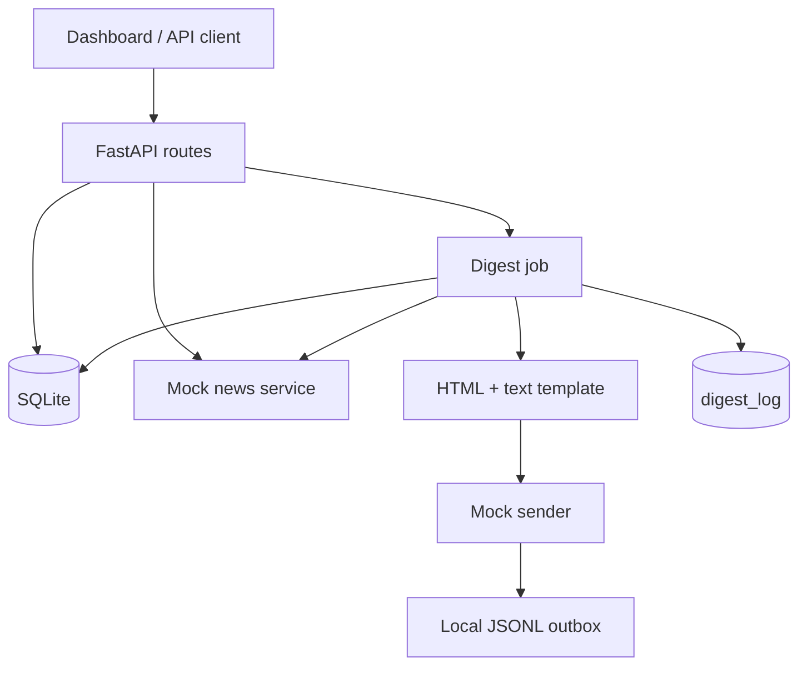

# System Architecture Document

**Project:** Personalized News Emailer — Team 15

## Architecture

Three tiers:
1. Presentation: HTML dashboard and Swagger API documentation.
2. Application: FastAPI routes, Pydantic validation, news filtering, digest orchestration, email rendering and mock dispatch.
3. Data: SQLite subscribers/preferences/digest history, JSON mock news source and local JSONL email outbox.

## Sprint 2 components

| Module | Responsibility |
|---|---|
| app/digest_job.py | Processes each subscriber independently; callable via API or CLI |
| app/email_template.py | Escaped HTML and plain-text email rendering |
| app/email_sender.py | Local JSONL mock outbox; no network delivery |
| app/database.py | Idempotent schema, subscriber enumeration and digest outcome history |

## Data model

- `users(id, email, created_at)`
- `topic_preferences(id, user_id, topic)`, unique per user/topic
- `digest_log(id, subscriber_email, run_id, run_at, status, article_count, subject, error)`

Allowed statuses: `sent`, `no_articles`, `failed`.

## Workflow

1. A manual API request or daily OS scheduler starts `python -m app.digest_job`.
2. The job loads subscribers and saved topics.
3. Articles are filtered separately for each subscriber.
4. Empty results are recorded as `no_articles`.
5. Non-empty results are rendered as HTML and text, then written to the local mock outbox.
6. Each result is persisted in `digest_log`; a failure for one subscriber does not stop later subscribers.

## Scheduling

No always-running scheduler library is required. The CLI command is scheduled with cron on Linux/macOS or Windows Task Scheduler. The README contains examples. The scheduled task must use the project directory and the same database/outbox environment variables as the application.

## Verification

Run `flake8 .` and `pytest --cov=app --cov-report=term-missing`. The digest test suite verifies subscriber-specific filtering, template escaping, local mock dispatch, empty/failure isolation, API invocation and history lookup.
